# ResolveAI: the complete guide

This guide explains what ResolveAI does, how it is built, how one investigation flows through the code, and how to run a live demo. It is written for engineers who are new to the codebase and for anyone presenting it.

**Contents:** [What it is](#1-what-it-is) · [Features in screenshots](#2-features-in-screenshots) · [Architecture](#3-architecture) · [How an investigation works](#4-how-an-investigation-works) · [Code map](#5-code-map) · [Data model](#6-data-model) · [AI providers and settings](#7-ai-providers-and-settings) · [Safety rules](#8-safety-rules) · [Live demo data](#9-live-demo-data) · [Run, configure and test](#10-run-configure-and-test) · [Extending ResolveAI](#11-extending-resolveai)

---

## 1. What it is

ResolveAI is an **incident investigation assistant**. When something breaks in production, an engineer opens the incident in ResolveAI. ResolveAI then:

1. **Collects evidence** from the systems around the service: log files, deploys and Git commits, metrics, and (optionally) SQL Server health. Every check is read-only.
2. **Finds similar past incidents** with full-text search. Code picks the candidates, not the AI.
3. **Asks an AI model** for ranked root-cause hypotheses. Every claim must cite the evidence by ID.
4. **Checks the AI's answer** in code. Citations to evidence that doesn't exist are removed, unsafe commands are stripped, and numbers that are not in the evidence are flagged.
5. **Keeps a person in charge.** Results are labelled *AI-generated — not confirmed* until an engineer records the verified cause. The engineer then drafts, edits and marks an RCA (root-cause analysis) as reviewed.

> ResolveAI never changes anything in your systems. It reads, explains and suggests checks; a person decides and acts.

**Tech stack:** .NET 10, Blazor Server (the UI runs on the server), SQLite with FTS5 full-text search, the Model Context Protocol (MCP) for the read-only system checks, and either **GitHub Copilot** (GitHub token) or **Anthropic Claude** (API key) as the model. A **recorded mode** replays analyses offline, so the app also works with no key and no network.

---

## 2. Features in screenshots

The screenshots show the app with the [live demo scenarios](#9-live-demo-data) injected and investigated by a live model.

### Incident queue

The home of the app. The *Start here* card picks the most urgent incident nobody has looked at. The four tiles count **Active**, **SEV-1**, **Needs review** (AI findings nobody has confirmed) and **Reviewed**. *Investigate All* runs every active incident in the current filter.

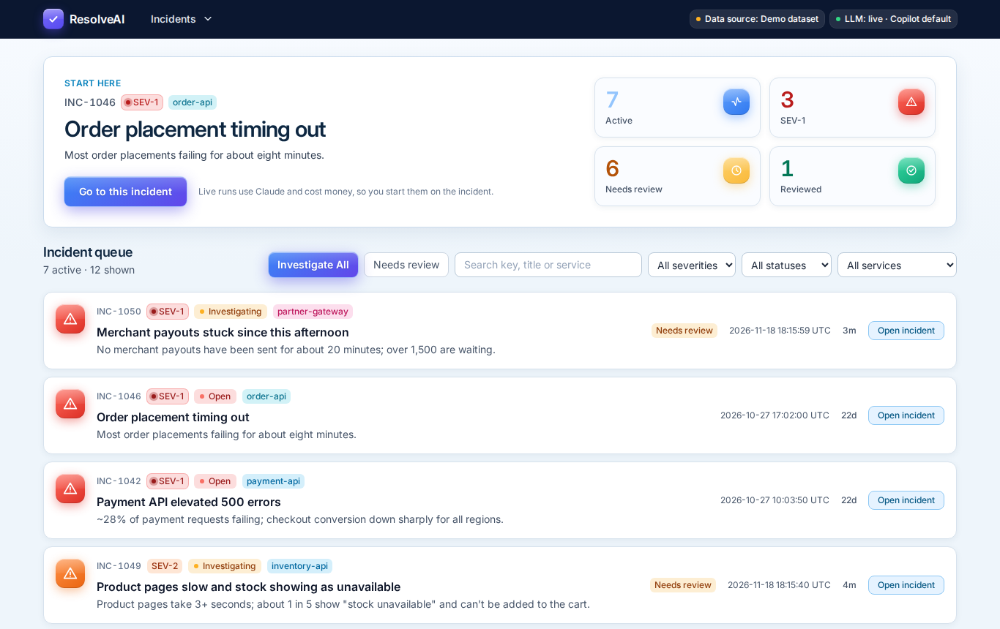

### Investigate a new incident

Describe what is happening in plain words. *Application name* links the incident to a known service so its logs, deploys and metrics can be found. The investigation starts as soon as you submit.

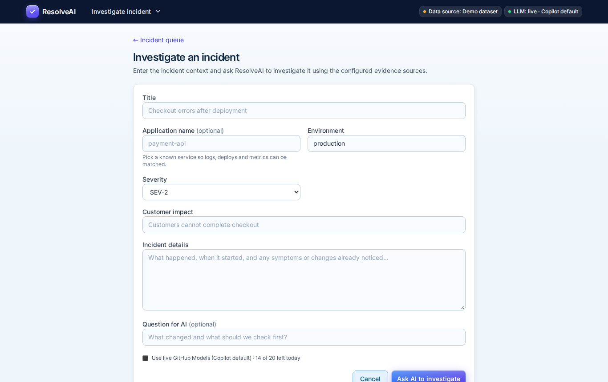

### AI findings

The top hypothesis, the evidence that supports it (each chip links to the exact record), and **Check this first**: what a person should verify, and what they should expect to see. Below it, *Observed facts* are computed from records by code, not written by the AI.

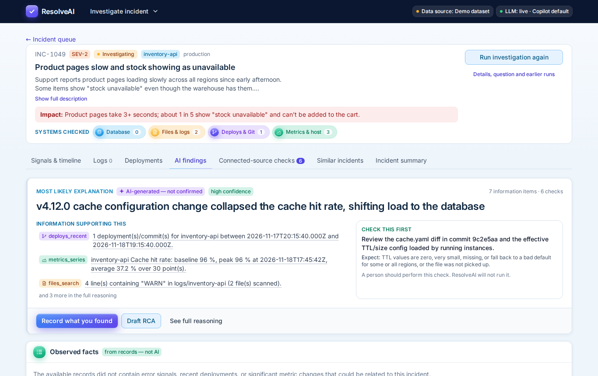

The AI also handles incidents where **nothing was deployed**. Here it blames an expired certificate, and it cites the deploy check that found no release:

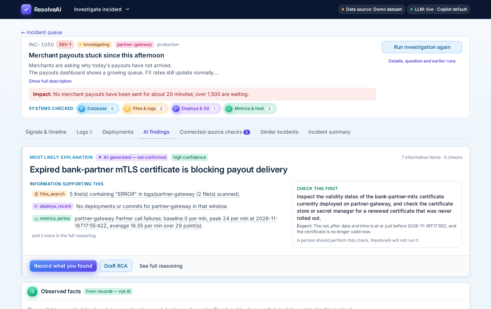

*See full reasoning* opens every hypothesis, the counter-evidence, validation notes and the stage-by-stage trace of how the result was produced:

<details><summary>Full reasoning (long screenshot)</summary>

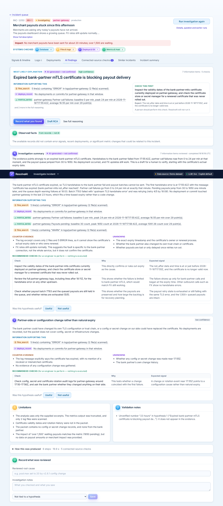

</details>

### Evidence tabs

| Signals & timeline | Deployments |
| --- | --- |
| 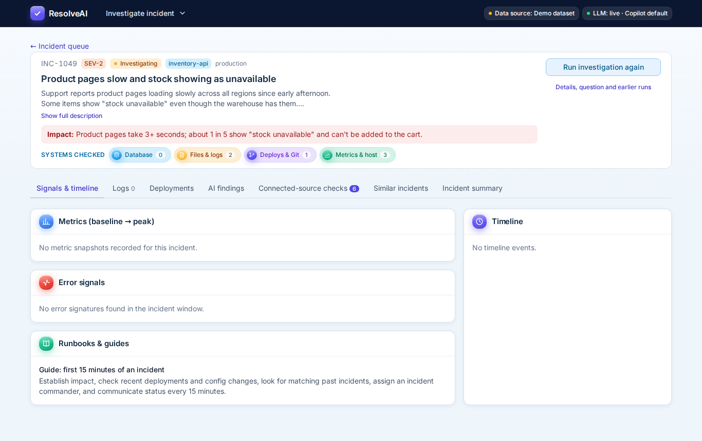 | 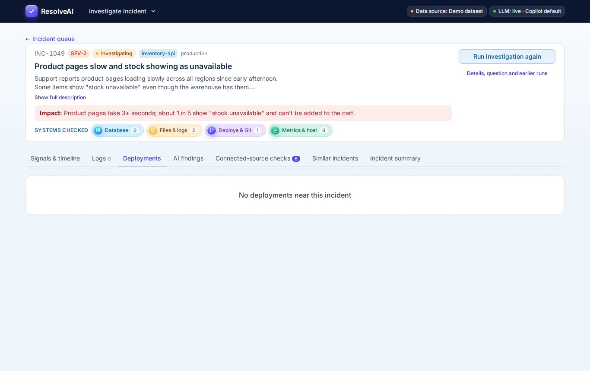 |

**Connected-source checks** list every MCP tool call: the exact arguments, the time window, the rows returned, and whether it was a baseline check or an AI follow-up. Each result becomes an evidence item `mcp:N` that the AI must cite.

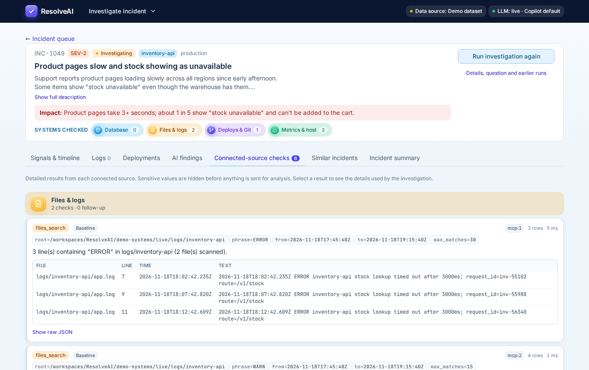

### Systems

Every connected system, whether it is working, and the read-only tools it offers.

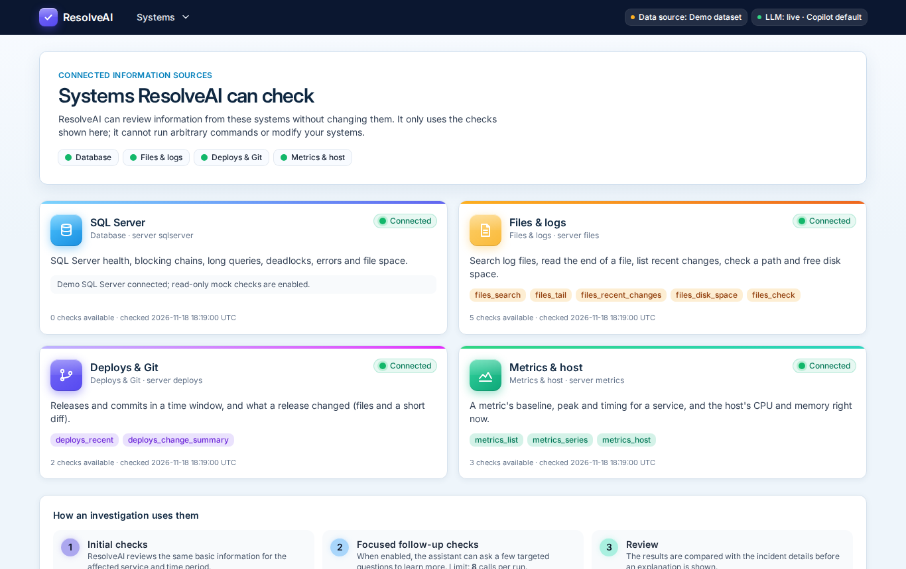

### Settings

Choose the AI provider and key, pick a model from the list your key can actually use, and test the connection before saving. The key is encrypted on the server and never sent back to the browser. The same page holds token usage per key, the **Microsoft Teams** webhook (with *Send test message*), the access code, and *Reset demo data*.

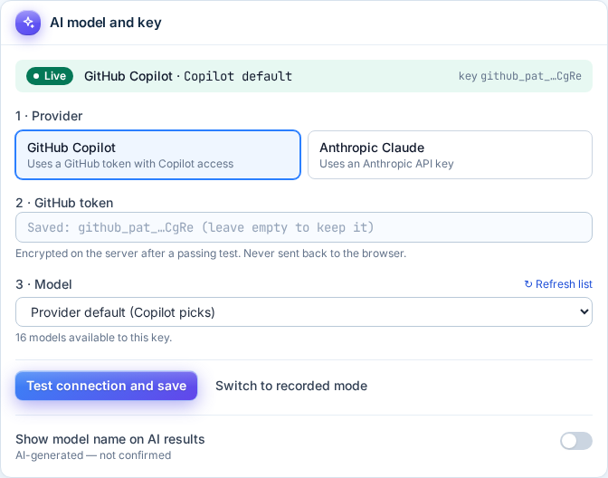

---

## 3. Architecture

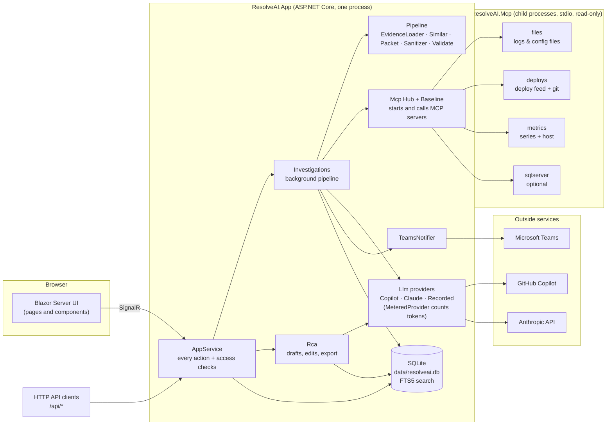

**Key design choices**

- **One gate for everything.** The UI and the HTTP API both call `AppService`, so the access code, daily live-call limit, input limits and ownership checks can't be bypassed from either side.
- **The model only analyses.** The model never decides what to collect for the baseline and never picks similar incidents. Code does both. In live mode with Claude, the model may ask for a limited number of extra read-only checks ("follow-ups").
- **Evidence has IDs.** Every log group, deploy, metric, timeline event, document and tool result gets a typed ID (`log:`, `dep:`, `met:`, `tl:`, `doc:`, `hist:`, `mcp:`). Validation checks every citation against those IDs.
- **MCP servers are separate processes** with a minimal environment: they never receive the API key, the GitHub token or the access code.
- **No accounts.** The app listens on `127.0.0.1` by default. An access code protects paid live runs and admin actions from other machines.

---

## 4. How an investigation works

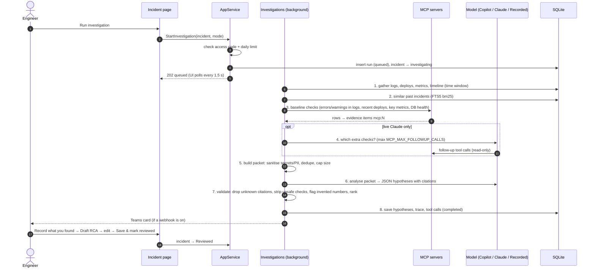

The stage text you see while it runs ("Gathering logs, deployments and metrics", "Checking systems…", "Analysing evidence with …") is written by `SetStage` in [`Services/Investigations.cs`](../src/ResolveAI.App/Services/Investigations.cs). Each stage's timing and counts are stored and shown under *How this was produced*.

### Review lifecycle

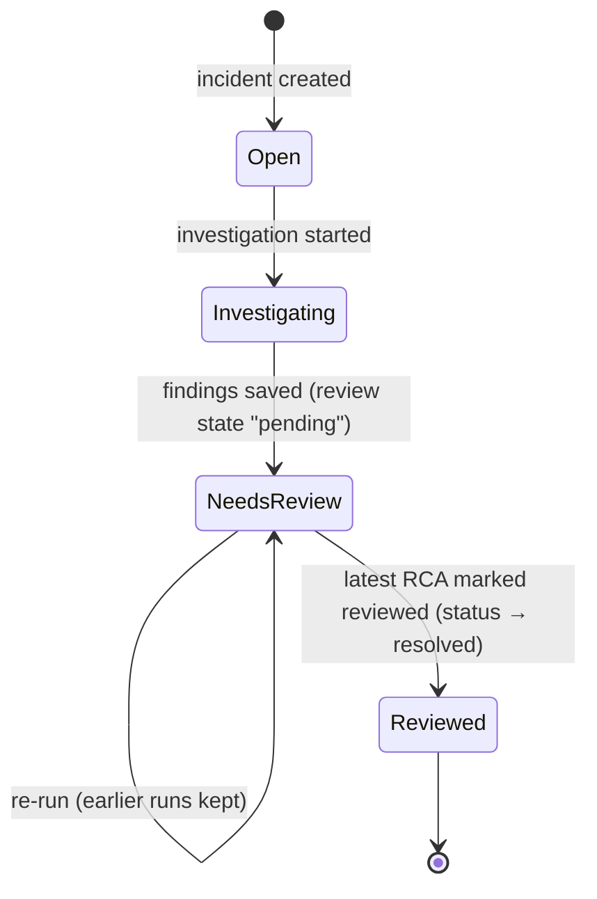

The queue has three buckets that never overlap. An incident is **Reviewed** when its stored status is `resolved` or a person marked its latest RCA reviewed (which also sets the status to `resolved`). Every other incident is **Active**. **Needs review** is the part of Active whose AI findings nobody has confirmed yet. The logic is in [`Services/Incidents.cs`](../src/ResolveAI.App/Services/Incidents.cs).

### Ranking and confidence

Ranking score = `2 × confidence weight (low 1, medium 2, high 3) + min(supporting citations, 5) − counter-evidence count`. The score only orders the hypotheses and is never shown as a probability. A hypothesis left with no valid citation is marked **speculative** and forced to low confidence. When the evidence is too thin, the app says so instead of guessing.

---

## 5. Code map

```
ResolveAI.sln
├── src/
│   ├── ResolveAI.App/            the web app (UI + API + pipeline)
│   │   ├── Program.cs            startup: settings, .env, DI, Origin check, restore saved model/Teams
│   │   ├── AppSettings.cs        every setting (.env / environment / appsettings.json)
│   │   ├── AppDeps.cs            opens the DB, seeds demo data, starts the MCP hub
│   │   ├── Api/ApiEndpoints.cs   the /api routes (thin: they call AppService)
│   │   ├── Services/
│   │   │   ├── AppService.cs     every action and permission check; Settings (model, Teams, prefs)
│   │   │   ├── Investigations.cs the background pipeline and its stages
│   │   │   ├── Incidents.cs      queue filters, review state, counts
│   │   │   ├── Rca.cs            RCA versions, edits, Markdown export
│   │   │   ├── LlmSettings.cs    saved model + key (encrypted), token usage, Teams URL storage
│   │   │   ├── TeamsNotifier.cs  Adaptive Card posts to a Teams webhook, test message
│   │   │   └── AccessCodeStore.cs access code kept (encrypted) in the browser
│   │   ├── Pipeline/
│   │   │   ├── EvidenceLoader.cs gathers stored evidence for the incident's time window
│   │   │   ├── Similar.cs        FTS5 search over past incidents
│   │   │   ├── Packet.cs         builds the evidence packet with typed IDs, size caps
│   │   │   ├── Sanitizer.cs      redacts tokens, keys, passwords, emails, card numbers
│   │   │   └── Validate.cs       citations, unsafe actions, invented numbers, ranking
│   │   ├── Llm/
│   │   │   ├── Provider.cs       ILlmProvider, IConnectionTest, IModelCatalog
│   │   │   ├── GitHubCopilotProvider.cs  GitHub Copilot SDK (lists models, tests, analyses)
│   │   │   ├── ClaudeProvider.cs Anthropic SDK: structured output + follow-up tool runner
│   │   │   ├── RecordedProvider.cs offline replay and rule-based analysis
│   │   │   ├── MeteredProvider.cs records tokens per key
│   │   │   ├── Prompts.cs        system and user prompts (bump Prompts.Version on change)
│   │   │   └── Schemas.cs        JSON output schemas and parsing
│   │   ├── Mcp/
│   │   │   ├── Hub.cs            starts MCP child processes, only exposes read-only tools
│   │   │   └── Baseline.cs       the fixed checks every investigation runs
│   │   ├── Data/
│   │   │   ├── Db.cs             SQLite access + migrations runner
│   │   │   ├── Migrations/       001..006 *.sql (add new files; never edit applied ones)
│   │   │   └── Seed.cs           the demo incidents, logs, deploys, metrics, history
│   │   └── Components/           Blazor UI
│   │       ├── Pages/            Investigate, Incident queue, Incident detail, Systems, Settings
│   │       ├── Incident/         tabs, findings, hypothesis cards, RCA editor, trace panel
│   │       └── Shared/           buttons, cards, chips, Ui.cs helpers (labels, colours, time)
│   ├── ResolveAI.Mcp/            the read-only MCP servers (one exe, four modes)
│   │   ├── FilesServer.cs        files_search, files_tail, files_recent_changes, files_disk_space, files_check
│   │   ├── DeploysServer.cs      deploys_recent, deploys_change_summary (feed + git, no shell)
│   │   ├── MetricsServer.cs      metrics_series, metrics_list, metrics_host
│   │   ├── SqlServerServer.cs    db_health, db_blocking, db_long_queries, db_deadlocks, … (EXECUTE AS reader)
│   │   └── ToolServer.cs         shared timeout, input checks, read-only annotations
│   └── ResolveAI.Contracts/      DTOs, evidence ID helpers, JSON options
├── demo-systems/                 synthetic logs, deploy feed, metrics, SQL scripts, live-demo scenarios
├── tests/
│   ├── ResolveAI.Tests/          unit, API and golden-file tests (in-memory DB)
│   ├── ResolveAI.E2E/            Playwright browser tests
│   └── ResolveAI.Evals/          scored diagnosis-quality eval (recorded or live)
├── docs/                         this guide, screenshots, design PDFs
└── tools/css/                    Tailwind build for wwwroot/app.css
```

---

## 6. Data model

All data is in one SQLite file (`data/resolveai.db` by default). Migrations in `Data/Migrations/` run automatically at startup.

| Table | What it holds |
| --- | --- |
| `incidents` | Key (`INC-1042`), title, service, severity, status (`open`, `investigating`, `mitigated`, `resolved`), times, description, impact |
| `log_events`, `deployments`, `metric_snapshots`, `timeline_events` | Stored evidence for seeded incidents. Log rows are immutable: a trigger rejects updates |
| `knowledge_documents`, `historical_incidents` | Runbooks and past RCAs, searchable with FTS5 |
| `investigations` | One row per run: status, stage, mode, model, summary, validation issues, token usage, stage trace |
| `hypotheses`, `evidence_links` | Ranked hypotheses and the evidence each one cites |
| `investigation_similar_incidents` | Similar past incidents found for a run |
| `tool_calls` | Every MCP call: tool, arguments, rows, duration, baseline or follow-up |
| `feedback` | Helpful / not helpful, comments, the verified root cause |
| `rca_drafts` | RCA versions (`draft` or `reviewed`) |
| `llm_settings`, `llm_usage` | The model and key saved on Settings (key encrypted), and tokens per key |
| `app_prefs` | Display and integration preferences: show model name, Teams on/off and webhook (encrypted) |

---

## 7. AI providers and settings

| Mode | When | What happens |
| --- | --- | --- |
| **Recorded** | No key, or `LLM_MODE=recorded` | INC-1042 replays a recorded analysis; other incidents get a rule-based analysis from the same packet. Free and deterministic |
| **GitHub Copilot** | A GitHub token with Copilot access | `GitHubCopilotProvider` uses the official GitHub Copilot SDK. No follow-up tool calls. Token counts are estimated (~4 characters per token) |
| **Anthropic Claude** | An Anthropic API key (or a compatible gateway) | `ClaudeProvider` uses structured JSON output and may make up to `MCP_MAX_FOLLOWUP_CALLS` read-only follow-up checks |
| **Live on request** | `LLM_MODE=recorded` + a key + `LIVE_ACCESS_CODE` | Everyone gets recorded mode; a person with the access code can tick *Use live* on an incident |

**Settings → AI model and key**

1. Pick the provider (GitHub Copilot or Anthropic Claude).
2. Paste the key. Leave it empty to keep the saved one.
3. Pick a model. The list comes from the provider for *your* key, so it only shows models you can use. *Provider default* lets the provider choose.
4. **Test connection and save** makes one tiny call. The key is saved (encrypted with ASP.NET Data Protection) only if the call passes. A failed test changes nothing; a model that already works keeps running.

Other settings on the same page:

- **Show model name on AI results** (off by default): adds the model to the *AI-generated — not confirmed* label.
- **Token usage by key**: calls and tokens today and in total, per key (only a fingerprint of the key is stored).
- **Microsoft Teams**: when on, every completed investigation posts an Adaptive Card to the channel webhook. The default URL comes from `TEAMS_WEBHOOK_URL` in `.env`; a URL entered on the page wins after a successful test message. *Send test message* checks the connection.
- **Access code**: needed for live runs and admin actions from outside localhost.
- **Reset demo data**: restores the seeded incidents.

> **Why "not confirmed"?** Every AI result keeps this label because no person has checked it; the engineer records the verified cause and marks the RCA reviewed. It stops people treating a guess as a fact. Even a "high confidence" answer is a hypothesis until someone checks it.

---

## 8. Safety rules

- **Read-only systems.** No tool runs arbitrary SQL or shell commands. Files are only read inside `files.allowed_roots`, and path escapes are refused. Git runs with fixed arguments and no shell. SQL Server queries run as `EXECUTE AS LOGIN = 'resolveai_reader'`.
- **Evidence is untrusted data.** Prompts tell the model that logs may contain instructions and must be ignored. INC-1044 has a prompt-injection log line to prove it.
- **Secrets are redacted** from evidence before the model sees it (bearer tokens, API keys, passwords, URL credentials, emails, card-like numbers).
- **Unsafe advice is stripped.** Recommended checks that describe destructive actions (`rm -rf`, `kubectl delete`, `DROP TABLE`, …) are removed by code.
- **Numbers are checked, not trusted.** A percentage, duration or count the model writes that is not in the evidence is flagged for a person.
- **Keys stay on the server.** Model keys and the Teams webhook are encrypted at rest, never sent back to the browser, and never passed to MCP child processes.
- **Limits.** A daily cap on live model calls (`LIVE_DAILY_LIMIT`), a time limit and row cap on every tool call, and a 24-hour window cap.

---

## 9. Live demo data

ResolveAI's MCP servers re-read files on every call. So you can **break a service "right now"** by writing fresh logs, a deploy and metrics. You then create the incident in the UI, and ResolveAI investigates evidence that did not exist when the app started.

The scenarios live in [`demo-systems/scenarios/`](../demo-systems/scenarios), one JSON file each. [`demo-systems/live-demo.py`](../demo-systems/live-demo.py) turns them into timestamped files under `demo-systems/live/`, which is git-ignored.

| Scenario | Service | Severity | What broke | Deploy? |
| --- | --- | --- | --- | --- |
| `inventory-cache-ttl` | inventory-api | SEV-2 | Cache TTL cut from 300 s to 5 s; hit rate collapses, DB overloaded, product pages time out | Yes (v4.12.0) |
| `partner-cert-expired` | partner-gateway | SEV-1 | bank-partner mTLS client certificate expired; payouts queue up | **No**: tests that the AI does not blame a release |
| `search-analyzer` | catalog-search | SEV-3 | Reindex used a mapping without accent folding; "crème brûlée" finds nothing | Yes (v2.4.0) |
| `email-rate-limit` | email-dispatcher | SEV-2 | Marketing campaign used the mail provider quota (429); password resets wait in a shared queue | **No** |
| `auth-keys` | auth-api | SEV-2 | Signing-key rotation dropped the old key; validators reject new tokens | Yes (v3.9.2) |
| `pinpoint-locale` | pinpoint | SEV-3 | New download index only has Japanese files; other languages get English | Yes (v7.3.0) |

**Run a live demo**

```bash
python3 demo-systems/live-demo.py setup                      # once: writes mcp.config.json for the demo services
# restart ResolveAI (Ctrl+C, then dotnet run --project src/ResolveAI.App)
python3 demo-systems/live-demo.py list                       # see the scenarios
python3 demo-systems/live-demo.py inject inventory-cache-ttl # just before the demo
```

`inject` prints the title, application name, severity, impact and details to paste into **Investigate incident**. It also prints the expected root cause, so the presenter knows the right answer. Run the investigation within about 20 minutes of `inject`, because the evidence is time-stamped relative to "now". To clean up, run `python3 demo-systems/live-demo.py reset` and restart.

`inject all` injects every scenario at once, which is handy for testing. With a live model, all six scenarios were diagnosed correctly in testing (see the screenshots above).

**Add a scenario:** copy one of the JSON files and change `id`, `service`, `logs` (`[minutes ago, level, message]`), `metrics` (`[unit, normal value, value after the change, minutes ago it changed]`), the optional `deploy` and `files`, and the `form`. Then run `setup` again so the new service is known. `{today}` and `{+Nd}`/`{-Nd}` in `files` become real dates.

On Windows without Python, `demo-systems/live-demo.ps1` runs the original two scenarios (`pinpoint-locale`, `auth-keys`).

---

## 10. Run, configure and test

```bash
dotnet run --project src/ResolveAI.App      # http://localhost:8787 (Codespaces forwards the port)
```

The first start creates and seeds `data/resolveai.db`. Only the .NET 10 SDK is required.

**Main settings** (`.env`, copied from `.env.example`; the real environment wins over the file):

| Variable | Purpose |
| --- | --- |
| `LLM_MODE` | `live` or `recorded`. Note: `dotnet run` uses `Properties/launchSettings.json`, which sets `LLM_MODE=live`; use `--no-launch-profile` to control it from the shell |
| `LLM_PROVIDER` | `github`, `anthropic` or `auto` |
| `GITHUB_COPILOT_TOKEN`, `GITHUB_COPILOT_MODEL` | GitHub Copilot token and model (empty = Copilot default). In a Codespace set the token explicitly; the automatic `GITHUB_TOKEN` has no Copilot access |
| `ANTHROPIC_API_KEY`, `CLAUDE_MODEL`, `ANTHROPIC_BASE_URL` | Anthropic key, model and optional gateway |
| `LIVE_ACCESS_CODE`, `LIVE_DAILY_LIMIT` | Access code for live runs and admin actions; daily cap on live model calls |
| `TEAMS_WEBHOOK_URL` | Default Microsoft Teams webhook. It is a secret: keep it in `.env`, never in committed files |
| `MCP_ENABLED`, `MCP_MAX_FOLLOWUP_CALLS`, `RESOLVEAI_MCP_CONFIG` | MCP systems on/off, follow-up limit, config path |
| `DB_PATH`, `API_PORT`, `HOST`, `DEMO_MODE` | Database file, port, listen address, demo reset |

A model and Teams webhook saved on the **Settings** page win over `.env`.

**Tests**

```bash
dotnet test tests/ResolveAI.Tests            # unit, API, golden files (in-memory DB)
dotnet test tests/ResolveAI.E2E              # browser tests (needs Chromium once)
dotnet run --project tests/ResolveAI.Evals   # scored eval in recorded mode (free)
```

---

## 11. Extending ResolveAI

| You want to… | Change |
| --- | --- |
| Check a new kind of system | Add `<Name>Server.cs` in `src/ResolveAI.Mcp` returning a `ToolServer`; register it in `ServerDefs` (`Program.cs`); add its style in `SystemStyle` (`Components/Shared/Ui.cs`); add baseline checks in `Mcp/Baseline.cs` |
| Point at real logs and repos | Copy `mcp.config.example.json` to `mcp.config.json` and map each service to its log folders, repo, database and key metrics |
| Add an AI provider | Implement `ILlmProvider` (and `IConnectionTest`, `IModelCatalog` for the Settings page) and add it to `LlmKeys.Build` |
| Change prompts | Edit `Llm/Prompts.cs`, bump `Prompts.Version`, update the golden files and read the diff |
| Change the database | Add `Data/Migrations/NNN_name.sql` (never edit an applied one) and update `DataTests` |
| Add a live demo story | Add a JSON file to `demo-systems/scenarios/` |
| Change styles | Edit classes, then run `sh tools/css/build.sh` to rebuild `wwwroot/app.css` |
